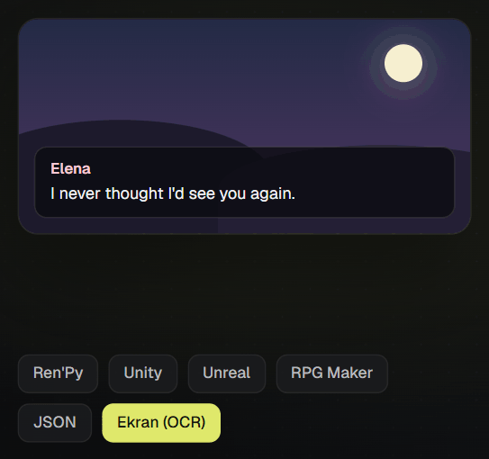
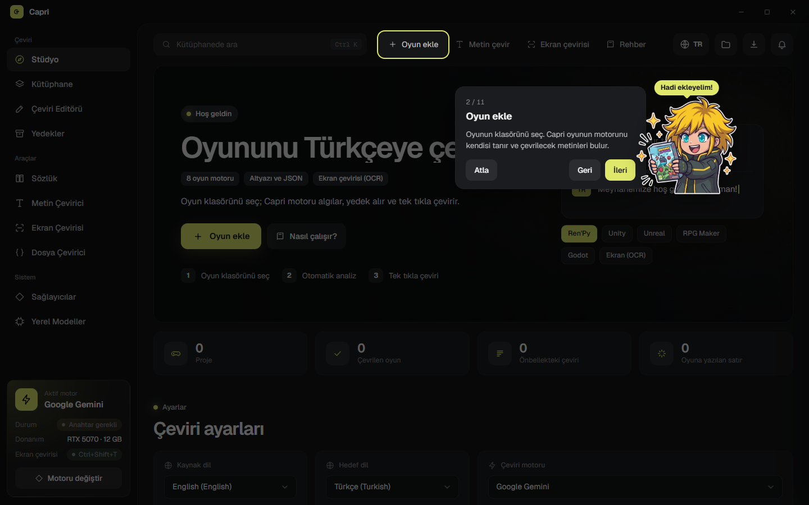
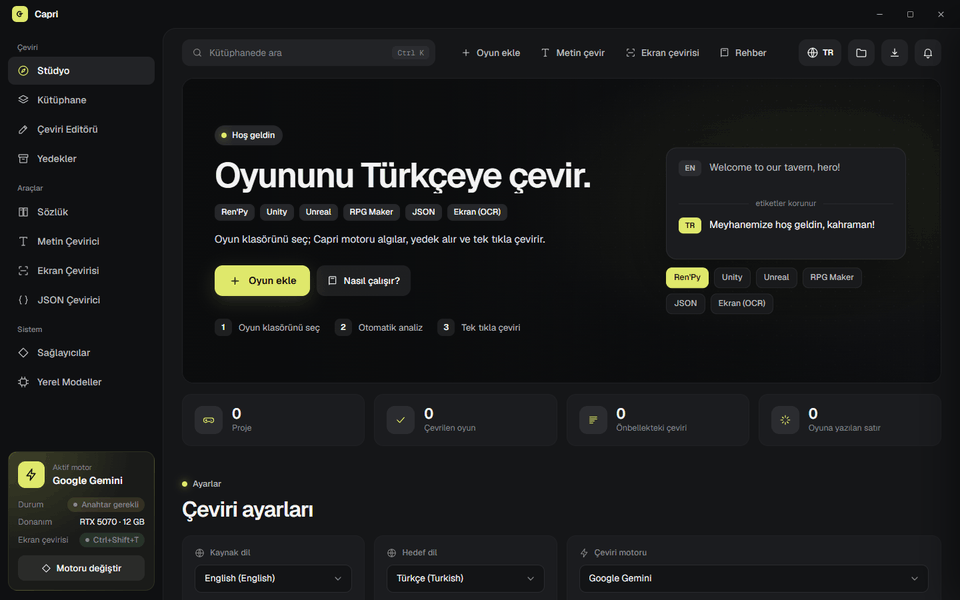
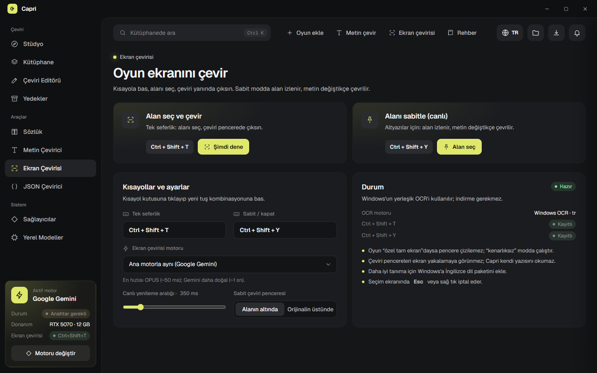
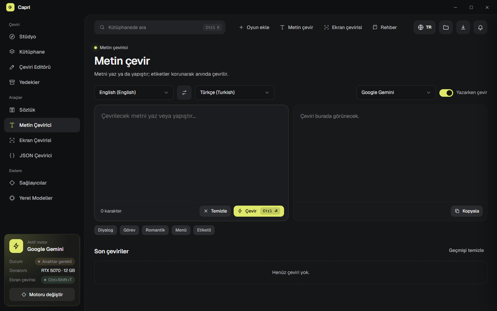

<div align="center">


# Capri

**Oyunları yapay zekâyla Türkçeye (ve 16 dile daha) çeviren masaüstü uygulaması.**
Ren'Py · Unity · Unreal Engine · RPG Maker · Godot · TyranoScript · KiriKiri · WOLF RPG · altyazı · ekran çevirisi


[](https://github.com/EmirkanAkin/Capri-Ceviri-Araci/releases/latest)


</div>

## Neler yapar?
- **Tek tıkla çeviri:** Oyun klasörünü seç; motor algılanır, dosyalar yedeklenir, çeviri oyuna yazılır.
- **Oyun bozulmaz:** `{i}`, `[mc]`, `\C[3]`, `<color>` gibi oyun kodları korunur; her değişiklik tek tıkla geri alınır.
- **Ekran çevirisi:** Kısayola bas, alanı seç, çeviri yanında çıksın. Altyazılar için alan sabitlenip canlı çevrilir.
- **Bulut ya da internetsiz:** Gemini, OpenAI, Claude, DeepL ve 11 bulut motoru daha; ya da bilgisayarında çalışan
  yerel modeller.
- **Düzelt ve paylaş:** Çeviri Editörü sorunlu satırları işaretler ve yapay zekâya düzelttirir; çevirini yama dosyası
  olarak paylaşabilirsin.
- **Toplu çeviri:** Oyunları sıraya ekle, teker teker çevrilsin.
- **Yol gösteren tur:** İlk açılışta ve her sayfada maskot Capri neyin nerede olduğunu kısaca anlatır.

## İndir
1. **[Capri-win64.zip](https://github.com/EmirkanAkin/Capri-Ceviri-Araci/releases/latest/download/Capri-win64.zip)** dosyasını indir.
2. İstediğin klasöre aç, **`Capri.exe`**'yi çalıştır. Kurulum gerekmez.
3. **Sağlayıcılar**'a bir API anahtarı gir (Gemini'nin ücretsiz anahtarı yeterli) ya da **Yerel Modeller**'den
   internetsiz bir model indir.

Güncellemeler uygulamanın içinden gelir. Windows 10/11 (64 bit) gerekir.

> **SmartScreen uyarısı:** Capri henüz kod imzalı değil; **Ek bilgi → Yine de çalıştır** ile açabilirsin. Sürüm
> paketi GitHub Actions ile bu depodaki koddan derlenir.

## Desteklenen oyunlar
| Motor | Ne çevrilir |
| --- | --- |
| **Ren'Py** | `.rpy`, `.rpyc`, `.rpa`; Türkçe font yaması, çevirinin derlenip denetlenmesi |
| **Unity** | Metin dosyaları, Unity Localization, I2, Utage, Naninovel, TextMeshPro; olmayanlarda BepInEx ile anlık çeviri |
| **Unreal Engine 4/5** | `.locres` (açık, `.pak` ya da IoStore içinde); çeviri ayrı bir yama paketi olur |
| **RPG Maker MV / MZ / XP / VX / VX Ace** | Diyaloglar, seçenekler, veritabanı, eklenti metinleri; şifreli arşivler |
| **Godot 3 / 4** | Çeviri tabloları, sahne yazıları ve betiklerdeki metinler; oyunun paketine dokunmayan yama |
| **TyranoScript · KiriKiri** | `.ks` senaryoları; NW.js / Electron paketleri, ayrı `patch.xp3` yaması |
| **WOLF RPG Editor 2 / 3** | Konuşmalar, seçenekler, veritabanı; şifreli `Data.wolf` arşivleri |
| **Diğer** | JSON dil dosyaları, `.srt / .vtt / .ass` altyazılar |

## Çeviri motorları


**Bulut:** Google Gemini, OpenAI, Claude, DeepL, DeepSeek, Mistral, Grok, Groq, OpenRouter, Cerebras, Qwen, Cohere,
Google Çeviri, Microsoft Translator ve OpenAI uyumlu kendi sunucun (LM Studio, vLLM…). Anahtarlar Windows'ta şifreli
saklanır.

**Yerel (internetsiz):** Model kitaplığı tek tıkla indirir; ek program gerekmez. Capri bilgisayarına en uygun modeli
önerir. Her grubun en iyisi, Capri'nin kendi testinde (WMT24++, chrF++):

| Model | Kimin için | Türkçe | 14 dil | İndirme |
| --- | --- | --- | --- | --- |
| Gemma 4 E2B | Zayıf bilgisayarlar, ekran kartsız da çalışır | 52,9 | 49,2 | 3,3 GB |
| Hy-MT2 7B | Çoğu oyun bilgisayarı (6-8 GB ekran kartı) | 55,7 | 50,8 | 4,6 GB |
| Gemma 4 26B-A4B | Güçlü ekran kartları (10 GB+) | 55,9 | 51,7 | 14,4 GB |
| MiLMMT-46 12B | 12 GB ekran kartı için önerilen | 56,4 | 48,3 | 7,3 GB |
| OPUS-MT | Yalnızca İngilizce → Türkçe, işlemcide çok hızlı | 52,4 | – | 0,5 GB |
| NLLB-200 | 200 dil, işlemcide çalışır (ticari olmayan kullanım) | 37,8 | 37,3 | 0,6 GB |

Kitaplıkta toplam 14 model var; hepsi uygulamada kalite ve hızlarıyla listelenir.


## Ekran çevirisi


- **`Ctrl+Shift+T`**: ekran donar, alanı seç, çeviri açılır.
- **`Ctrl+Shift+Y`**: alanı sabitle; metin değiştikçe yeniden çevrilir.
- Windows'un yerleşik metin tanıma özelliği kullanılır; indirme gerekmez.
- İstersen çeviri Windows'un sesiyle sesli okunur.

<br clear="right">

## Rehberli tur


İlk açılışta kısa bir tanıtım turu, ilk oyunu ekleyince çeviri adımları ve her sayfanın kendi kısa turu gelir.
Turları maskot Capri anlatır; başlıkların yanındaki **?** ile istediğin zaman yeniden açabilirsin.

## Ekran görüntüleri


| Ekran çevirisi | Metin çevirici |
| --- | --- |
|  |  |

## Güvenlik ve gizlilik
- Oyun dosyaları değiştirilmeden önce yedeklenir; Yedekler sayfasından tek tıkla orijinale dönülür.
- Ek araçlar (BepInEx, repak, yerel model ortamı…) yalnızca gerektiğinde ve onayınla resmi kaynaklarından indirilir.
- Metinler yalnızca seçtiğin sağlayıcıya gider; yerel modellerde bilgisayarından çıkmaz. Capri kullanım verisi
  toplamaz ([gizlilik](PRIVACY.md)).
- Kaldırmak için klasörü silmen yeterli.

## Geliştirme
```bash
git clone https://github.com/EmirkanAkin/Capri-Ceviri-Araci.git
cd Capri-Ceviri-Araci
pip install -r requirements.txt     # Python 3.11
pythonw Capri.pyw                   # kaynak koddan çalıştır
python -m pytest -m "not slow"      # testler
python build_exe.py --zip           # dist/Capri-win64.zip
```

Sürüm için `src/app_modern.py`'deki `APP_VERSION`'ı artır, [CHANGELOG.md](CHANGELOG.md)'ye bölüm ekle ve `v<sürüm>`
etiketini gönder; GitHub Actions test eder, derler ve yayımlar.

## Lisans
[MIT](LICENSE) · [Üçüncü taraf bildirimleri](THIRD_PARTY_NOTICES.md) · [Değişiklikler](CHANGELOG.md) ·
[Yol haritası](docs/YOL_HARITASI.md) · Yazar: [EmirkanAkin](https://github.com/EmirkanAkin)
