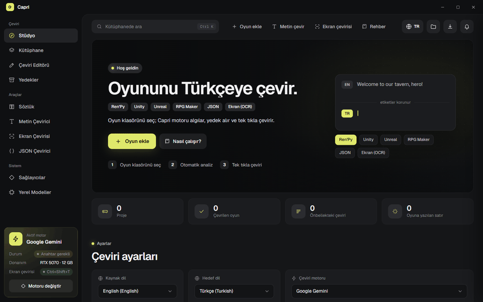
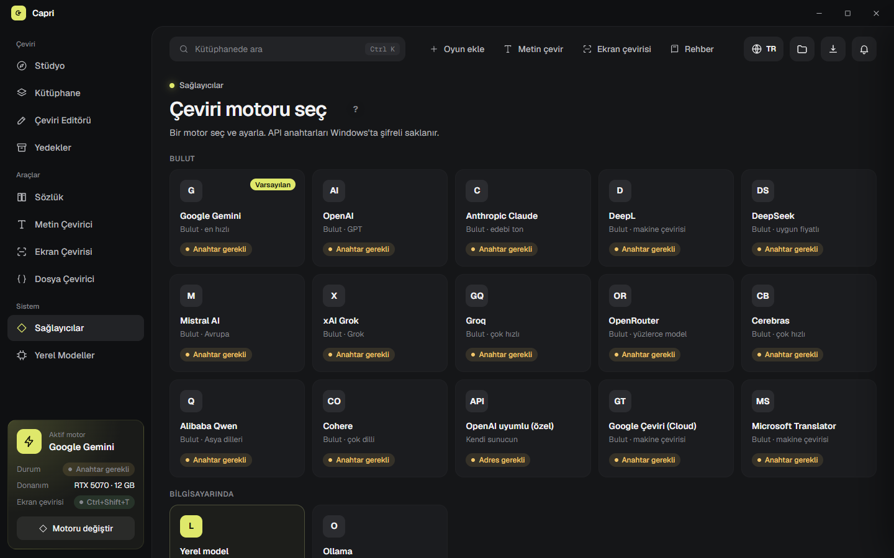
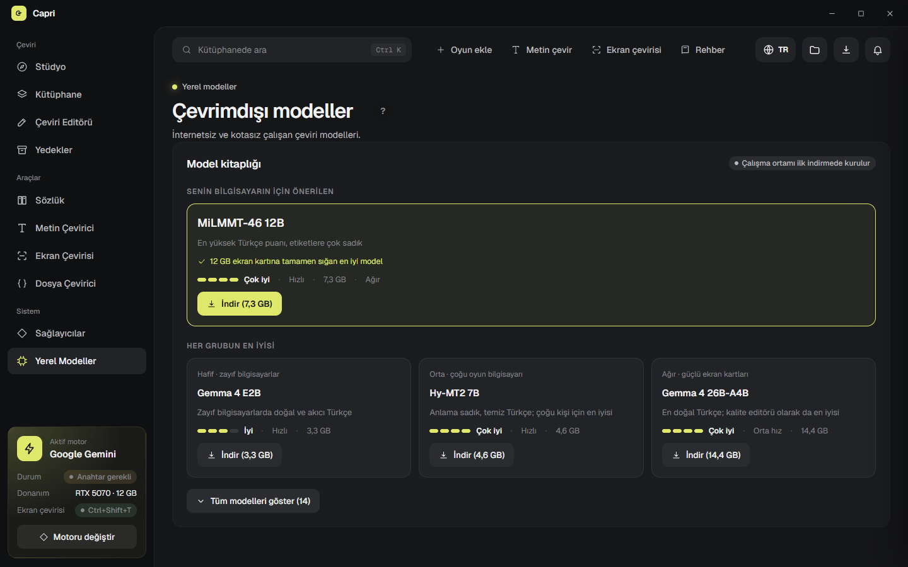

<div align="center">


# Capri

**Oyunları yapay zekâyla Türkçeye (ve 17 dile) çeviren masaüstü uygulaması.**
Ren'Py · Unity · Unreal Engine · RPG Maker · JSON · ekran çevirisi (OCR)


[](https://github.com/EmirkanAkin/Capri-Ceviri-Araci/releases/latest)




</div>

## Neler yapar?
- **Tek tıkla oyun çevirisi:** Oyun klasörünü seç; motor algılanır, dosyalar yedeklenir, çeviri oyuna yazılır.
  Durdurursan kaldığın yerden, yeniden ödemeden devam eder.
- **Oyun kodları bozulmaz:** `{i}`, `[mc]`, `\C[3]`, `{0}`, `<color>` gibi etiketler korunur.
- **Ekran çevirisi:** Kısayola bas, alanı seç, çeviri yanında çıksın. Altyazılar için alan sabitlenip canlı çevrilir.
- **Bulut ya da yerel:** Gemini, OpenAI, Claude, DeepL ya da internetsiz yerel modeller (TranslateGemma, OPUS-MT, NLLB).
- **Düzelt ve paylaş:** Çeviri Editörü'nde satırları düzelt, `.capripatch` olarak paylaş.
- **Geri alınabilir:** Her değişiklik yedeklenir; Yedekler sayfasından tek tıkla orijinale dönülür.

## İndir
1. **[Capri-win64.zip](https://github.com/EmirkanAkin/Capri-Ceviri-Araci/releases/latest/download/Capri-win64.zip)** dosyasını indir.
2. İstediğin klasöre aç, **`Capri.exe`**'yi çalıştır. Kurulum gerekmez.
3. Bulut motoru için **Sağlayıcılar**'a API anahtarını gir (Gemini'nin ücretsiz anahtarı yeterli) ya da
   **Yerel Modeller**'den internetsiz bir model indir.

Güncellemeler uygulama içinden gelir; ayarların korunur. Windows 10/11 64 bit ve WebView2 gerekir (Windows 11'de hazır).

> **SmartScreen uyarısı:** Capri henüz kod imzalı değil. **Ek bilgi → Yine de çalıştır** ile açabilirsin. Sürüm paketi
> GitHub Actions ile bu depodaki koddan derlenir.

## Desteklenen oyunlar
| Motor | Ne çevrilir |
| --- | --- |
| **Ren'Py** | `.rpy`, `.rpyc`, `.rpa`; otomatik font yaması |
| **Unity** | TextAsset, StreamingAssets, Utage, I2 Localization, PlayMaker, UI Text / TextMeshPro, çok dilli XML, **Naninovel** (tek paket `data.unity3d` dahil). Dosyada metni olmayan oyunlarda BepInEx + XUnity.AutoTranslator |
| **Unreal Engine 4/5** | `.locres` (açık, `.pak` ya da IoStore içinde); çeviri `~mods` yama paketi olur |
| **RPG Maker MV / MZ** | `data/*.json`: diyalog, seçenekler, veritabanı, terimler |
| **RPG Maker XP / VX / VX Ace** | `.rxdata / .rvdata / .rvdata2`, şifreli arşivler dahil |
| **Diğer** | Herhangi bir `.json` dil dosyası |

## Çeviri motorları


| Motor | Nerede | Not |
| --- | --- | --- |
| Google Gemini | Bulut | Hızlı; birden fazla anahtar paralel çalışır |
| OpenAI · Claude · DeepL | Bulut | API anahtarıyla |
| Yerel model | Bilgisayarında | TranslateGemma 4B/12B, MiLMMT (ekran çevirisi), OPUS-MT (EN→TR), NLLB-200. Ek program gerekmez |
| Ollama | Bilgisayarında | Ollama kuruluysa aynı modeller onun üzerinden |

Yerel modeller tek tıkla iner ve SHA-256 ile doğrulanır. TranslateGemma 4B, 4 GB ekran kartında saniyede ~10 satır
çevirir; 12B en iyi kaliteyi verir (10 GB+ ekran kartı). Modeller Gemma kullanım şartlarına, NLLB ticari olmayan
kullanım lisansına (CC-BY-NC 4.0) tabidir.

## Ekran çevirisi (OCR)


- **`Ctrl+Shift+T`**: ekran donar, alanı seç, çeviri açılır.
- **`Ctrl+Shift+Y`**: alanı sabitle; metin değiştikçe yeniden çevrilir.
- Windows'un yerleşik OCR'ı kullanılır; indirme gerekmez.
- Çeviri pencereleri ekran yakalamaya görünmez, Capri kendi yazısını okumaz.

<br clear="right">

## Ekran görüntüleri


| Yerel modeller | Ekran çevirisi | Metin çevirici |
| --- | --- | --- |
|  |  |  |

## Güvenlik ve gizlilik
- API anahtarları Windows Kimlik Bilgisi Yöneticisi'nde şifreli saklanır.
- Oyun dosyaları değiştirilmeden önce yedeklenir.
- Ek araçlar (repak, BepInEx, PyTorch, Unity bileşen okuyucusu) yalnızca gerektiğinde ve **onayın alınarak** resmi
  kaynaklarından indirilir.
- Metinler yalnızca seçtiğin sağlayıcıya gider; yerel modellerde bilgisayarından çıkmaz. Capri kullanım verisi
  toplamaz ([gizlilik](PRIVACY.md)).
- Kaldırmak için klasörü silmen yeterli (önce oyunları Yedekler'den orijinaline döndürebilirsin).

## Geliştirme
```bash
git clone https://github.com/EmirkanAkin/Capri-Ceviri-Araci.git
cd Capri-Ceviri-Araci
pip install -r requirements.txt     # Python 3.11
pythonw Capri.pyw                   # kaynak koddan çalıştır
python -m pytest -m "not slow"      # testler
python build_exe.py --zip           # dist/Capri-win64.zip
```

Sürüm yayımlamak için `src/app_modern.py` içindeki `APP_VERSION`'ı artır, [CHANGELOG.md](CHANGELOG.md)'ye bölüm ekle ve
`v<sürüm>` etiketini gönder; GitHub Actions test eder, derler ve yayımlar.

```text
src/       Uygulama: app_modern.py (giriş, arayüz köprüsü), engine_*.py (motorlar), unity_*.py, unreal_*.py,
           rgss_*.py (motor yardımcıları), providers.py ve local_llm.py (çeviri motorları), ocr.py, i18n*.py
web/       Arayüz (HTML/CSS/JS) ve OCR pencereleri
data/      Varsayılan sözlükler ve arayüz dilleri
tests/     pytest testleri
docs/      README görselleri ve yol haritası
```

## Lisans
[MIT](LICENSE) · Kullanılan bileşenler: [üçüncü taraf bildirimleri](THIRD_PARTY_NOTICES.md) ·
Planlar: [yol haritası](docs/YOL_HARITASI.md) · Yazar: [EmirkanAkin](https://github.com/EmirkanAkin)
