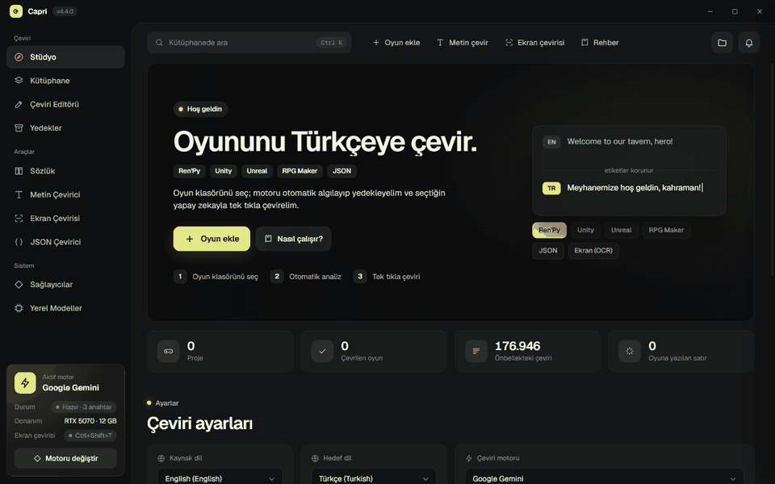
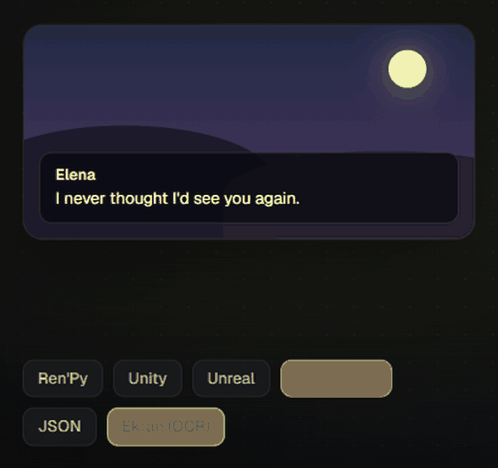
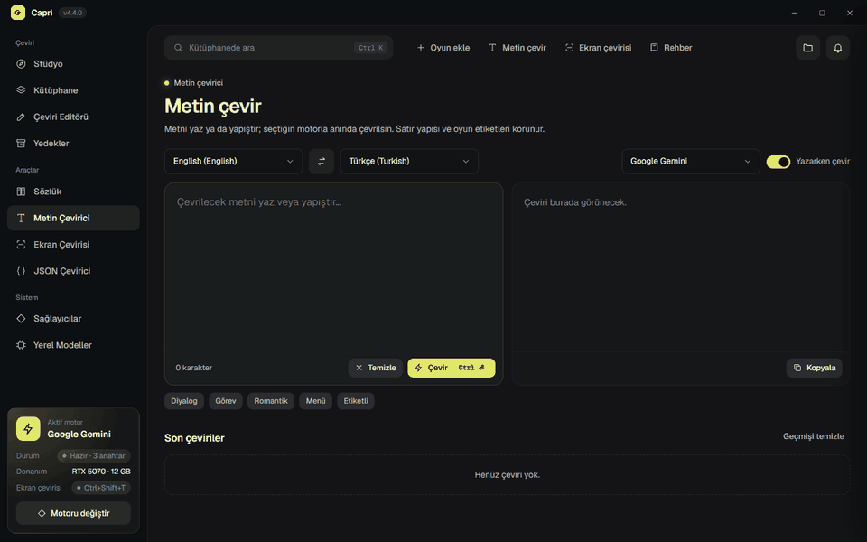
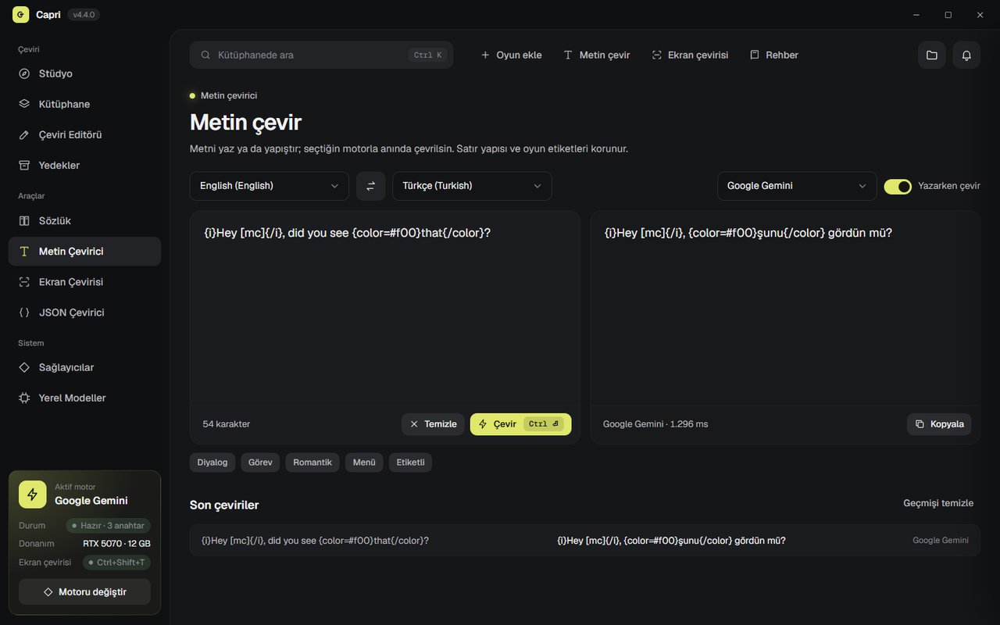
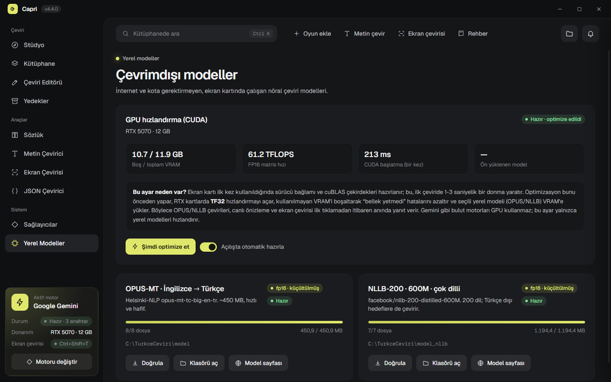
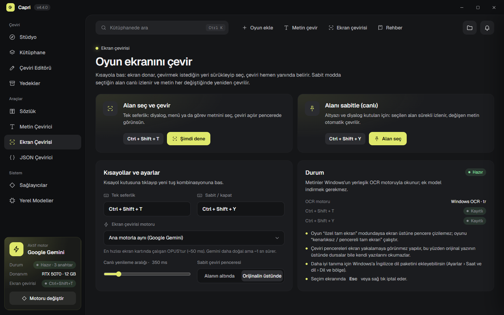
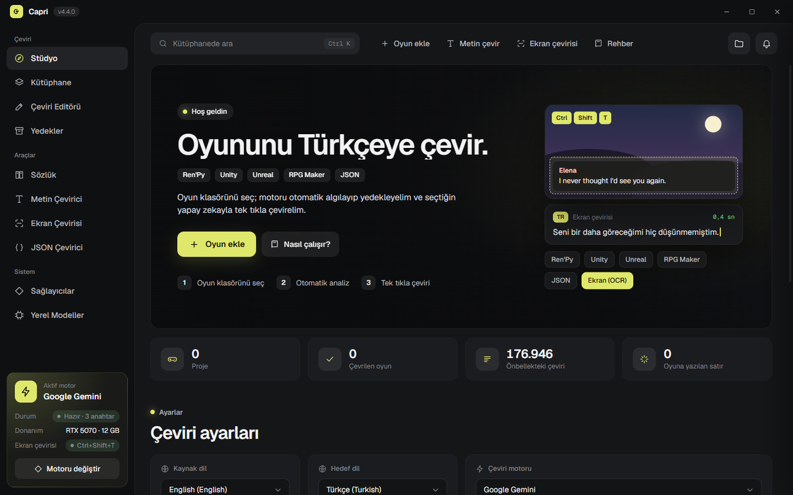

<div align="center">


# Capri

**Oyunları yapay zekâyla Türkçeye (ve 17 dile) çeviren masaüstü stüdyo.**
Ren'Py · Unity · Unreal Engine · RPG Maker · JSON — artı oyun ekranını canlı çeviren OCR.


[](https://github.com/EmirkanAkin/Capri-Ceviri-Araci/releases/latest)




</div>

## İçindekiler
- [Öne çıkanlar](#öne-çıkanlar)
- [İndir ve çalıştır](#indir-ve-çalıştır)
- [Desteklenen oyun motorları](#desteklenen-oyun-motorları)
- [Çeviri motorları](#çeviri-motorları)
- [Ekran çevirisi (OCR)](#ekran-çevirisi-ocr)
- [Ekran görüntüleri](#ekran-görüntüleri)
- [Güvenlik ve gizlilik](#güvenlik-ve-gizlilik)
- [Kaynak koddan çalıştırma](#kaynak-koddan-çalıştırma)
- [Proje yapısı](#proje-yapısı)
- [Lisans ve proje ekibi](#lisans-ve-proje-ekibi)

## Öne çıkanlar
- **Tek tıkla oyun çevirisi:** Oyun klasörünü sürükleyip bırak; motor otomatik algılanır, metinler çıkarılır,
  dosyalar yedeklenir ve çeviri oyuna yazılır. Durdurup kaldığın yerden devam edebilirsin.
- **Etiketler bozulmaz:** `{i}`, `[mc]`, `\C[3]`, `{0}`, `<color>` gibi oyun kodları korunur; bozulan satırlar
  inceleme listesine düşer.
- **Ekran çevirisi:** Kısayola bas, alanı seç, çeviri anında çıksın. Ya da alanı sabitle, metin değiştikçe
  canlı çevrilsin.
- **Oyuna özel bağlam:** Karakter adları otomatik taranır; terimler, hitap (sen/siz) ve oyun notları yapay
  zekâya talimat olarak gider.
- **Çeviri Editörü ve yama paylaşımı:** Satırları düzelt, API harcamadan oyuna uygula, `.capripatch` olarak paylaş.
- **Şifreli arşivler:** RPG Maker `Game.rgss3a / .rgss2a / .rgssad` arşivleri dahili olarak açılır; Unreal `.pak`
  paketleri için gereken araç, sana sorulduktan sonra kurulur.
- **Otomatik oyun bulma:** Steam, Epic, GOG ve oyun klasörlerindeki çevrilebilir oyunlar kütüphanede öneri olarak çıkar.
- **Çevrimdışı mod:** OPUS-MT ve NLLB-200 ekran kartında, internetsiz ve kotasız çalışır.

## İndir ve çalıştır
1. **[Capri-win64.zip](https://github.com/EmirkanAkin/Capri-Ceviri-Araci/releases/latest/download/Capri-win64.zip)** dosyasını indir
   (ya da [Sürümler](https://github.com/EmirkanAkin/Capri-Ceviri-Araci/releases) sayfasından).
2. Zip'i istediğin klasöre aç ve **`Capri.exe`**'yi çalıştır. Kurulum gerekmez; klasörü dilediğin yere
   taşıyabilirsin. Ayarlar, önbellekler ve modeller bu klasörde tutulur.
3. Bulut motorları (Gemini, OpenAI, Claude, DeepL) için **Sağlayıcılar** sayfasına API anahtarını gir.
   Gemini'nin ücretsiz anahtarı başlamak için yeterli.
4. **Güncellemeler:** Yeni sürüm çıkınca Capri açılışta haber verir. İstediğin an üst çubuktaki indirme simgesine
   basıp kontrol edebilirsin; "İndir ve kur" dediğinde indirir, kurar ve yeniden açılır. Ayarların, sözlüklerin,
   önbelleklerin ve modellerin korunur.

> **"Windows kişisel bilgisayarınızı korudu" uyarısı çıkarsa:** Capri henüz kod imzalı olmadığı için SmartScreen
> yeni uygulamalarda bu uyarıyı gösterebilir. **Ek bilgi → Yine de çalıştır** ile açabilirsin. Kaynak kodun tamamı bu
> depoda, sürüm paketi de GitHub Actions ile buradaki koddan derleniyor.

> **Gerekenler:** Windows 10/11 64 bit ve Microsoft Edge WebView2 (Windows 11'de hazır gelir).
> Yerel modelleri ilk kez kullandığında Capri, ekran kartına uygun PyTorch'u (NVIDIA'da ≈2,9 GB) indirmek için
> izin ister; modeller **Yerel Modeller** sayfasından tek tıkla iner.

## Desteklenen oyun motorları
| Motor | Ne çevrilir | Notlar |
| --- | --- | --- |
| **Ren'Py** | `.rpy`, `.rpyc`, `.rpa` | 17 hedef dil, diyalog sırasıyla bağlamlı çeviri, Türkçede kalite turu, otomatik font yaması |
| **Unity** | `resources.assets` TextAsset, StreamingAssets | BepInEx + XUnity.AutoTranslator otomatik kurulumu (Mono / IL2CPP) |
| **Unreal Engine 4/5** | `.locres` (açık, `.pak` ya da `.utoc` içinde) | Paketler `repak` / `retoc` ile okunur, çeviri `Paks/~mods` altına yama paketi olur; şifreli oyunlarda AES anahtarı girilebilir |
| **RPG Maker MV / MZ** | `data/*.json` | Diyalog, seçenekler, veritabanı, sistem terimleri |
| **RPG Maker XP / VX / VX Ace** | `Data/*.rxdata / .rvdata / .rvdata2` | Değişmeyen her bayt korunur; şifreli arşivler otomatik açılır ve yedeklenir |
| **Diğer** | Herhangi bir `.json` dil dosyası | JSON Çevirici: anahtarlar ve kod parçaları korunur |

## Çeviri motorları
| Motor | Tür | Öne çıkan |
| --- | --- | --- |
| Google Gemini | Bulut | Tüm uygun modeller hız sırasıyla denenir; birden fazla anahtarla paralel çeviri |
| OpenAI · Claude · DeepL | Bulut | Etiket doğrulamalı toplu çeviri |
| Ollama | Yerel LLM | Kendi bilgisayarında çalışan modeller |
| OPUS-MT | Yerel (GPU) | İngilizce → Türkçe, çok hızlı |
| NLLB-200 | Yerel (GPU) | 200 dil; fp16'ya küçültülebilir (2,3 → 1,2 GB) |

## Ekran çevirisi (OCR)


- **`Ctrl+Shift+T`** → ekran donar, alanı sürükle, çeviri temaya uygun bir pencerede açılır (kopyala / sabitle).
- **`Ctrl+Shift+Y`** → alanı sabitle; metin değiştikçe yeniden okunur ve çevrilir. Aynı kısayol kapatır.
- Windows'un yerleşik OCR motoru kullanılır (alan başına ~5-15 ms). Fare hangi monitördeyse orası yakalanır.
- Çeviri pencereleri ekran yakalamaya görünmez; Capri kendi yazdığını tekrar okumaz.
- En hızlı canlı çeviri için motoru OPUS (GPU) seç: değişimden ekrana ~0,4 sn.

<br clear="right">

## Ekran görüntüleri


| Metin çevirici | Yerel modeller ve GPU |
| --- | --- |
|  |  |
| **Ekran çevirisi ayarları** | **Stüdyo** |
|  |  |

## Güvenlik ve gizlilik
- **API anahtarları** Windows Kimlik Bilgisi Yöneticisi'nde şifreli (DPAPI) saklanır; diske düz metin yazılmaz.
- **Oyun dosyaları** değiştirilmeden önce yedeklenir; **Yedekler** sayfasından tek tıkla geri alınır.
  Açılan şifreli arşivler ve eklenen yama paketleri de geri alınabilir.
- **Ek araçlar ve kütüphaneler** (repak, BepInEx, PyTorch) yalnızca gerektiğinde ve **sana ne kurulacağı
  söylenip onay alındıktan sonra** resmi kaynaklarından indirilir.
- Metinler yalnızca seçtiğin çeviri sağlayıcısına gönderilir; yerel modellerde bilgisayarından çıkmaz.
- Capri kullanım verisi toplamaz. Hangi durumda nereye bağlandığı [gizlilik sayfasında](PRIVACY.md) yazıyor.
- **Kaldırmak için** uygulama klasörünü silmen yeterli. Çevirdiğin oyunları önce **Yedekler** sayfasından orijinaline
  döndürebilirsin; kayıtlı API anahtarları Windows Kimlik Bilgisi Yöneticisi'nden silinebilir.

## Kaynak koddan çalıştırma
```bash
git clone https://github.com/EmirkanAkin/Capri-Ceviri-Araci.git
cd Capri-Ceviri-Araci
pip install -r requirements.txt     # Python 3.11
pythonw Capri.pyw                   # ya da: python app_modern.py
```

Taşınabilir sürümü derlemek için:
```bash
python build_exe.py --zip           # dist/Capri + dist/Capri-win64.zip
```

**Yeni sürüm yayımlamak:** `src/app_modern.py` içindeki `APP_VERSION` değerini artır, `CHANGELOG.md`'ye bölüm ekle ve
`git tag v<sürüm> && git push --tags` çalıştır. GitHub Actions test eder, derler ve sürümü zip'iyle yayımlar.
Güncelleme kaynağı derleme sırasında git'in `origin` adresinden okunup exe'ye yazılır; kullanıcıların hiçbir
ayar yapması gerekmez.

Testler:
```bash
python -m pytest            # GPU/model yoksa ilgili testler atlanır
python -m pytest -m "not slow"
```

## Proje yapısı
```text
Capri.pyw            Konsolsuz başlatıcı (kaynak koddan)
build_exe.py         Taşınabilir sürüm derleme
src/                 Uygulama kaynak kodu
  app_modern.py        Arayüz köprüsü ve çeviri iş akışları (giriş noktası)
  engine_renpy.py      Ren'Py (rpy/rpyc/rpa, şablonlar, Gemini, font yaması)
  engine_unity.py      Unity (TextAsset, StreamingAssets) · unity_bepinex.py, bepinex_installer.py
  engine_unreal.py     Unreal (.locres) · unreal_pak.py (.pak / repak), unreal_modding.py (~mods)
  engine_rpgmaker.py   RPG Maker MV/MZ ve XP/VX/VX Ace · rgss_marshal.py, rgss_archive.py
  engine_json.py       Motor bağımsız JSON çevirici
  engine_common.py     Önbellek, çeviri belleği, sözlük, kalite denetimi, yerel motorlar
  providers.py         Sağlayıcılar, bağlantı testleri, model indirme · languages.py
  progress.py          Süre tahmini ve canlı kalan süre · user_errors.py (anlaşılır hata metinleri)
  gpu_runtime.py       Yerel model ortamı (PyTorch) kurulumu
  game_scanner.py      Bilgisayardaki oyunları bulma
  ocr.py               Ekran çevirisi: yakalama, Windows OCR, canlı izleyici, kısayollar
  library.py           Proje kütüphanesi ve Steam kapak görselleri
  backup_system.py     Yedekleme / geri yükleme
  secrets_store.py     Windows Kimlik Bilgisi Yöneticisi
  updater.py           Uygulama içi güncelleme
  paths.py             Kaynak kod / exe klasör düzeni
web/                 Arayüz: index.html, app.css, app.js, OCR pencereleri, fontlar
data/                Varsayılan sözlükler (genel, RPG Maker, yetişkin, terimler)
assets/              Logo ve uygulama simgesi
docs/                README görselleri ve yol haritası
tests/               pytest testleri
```

Değişiklikler için [CHANGELOG.md](CHANGELOG.md), planlanan işler için [docs/YOL_HARITASI.md](docs/YOL_HARITASI.md).

## Lisans ve proje ekibi
Capri [MIT lisansı](LICENSE) ile dağıtılır. Kullanılan bileşenler: [üçüncü taraf bildirimleri](THIRD_PARTY_NOTICES.md).

**Ekip:** Yazar, gözden geçiren ve sürüm onaylayan: [EmirkanAkin](https://github.com/EmirkanAkin).

**Kod imzalama:** Sürümler şu an imzasızdır; SignPath Foundation'ın açık kaynak programına başvuru planlanıyor.
